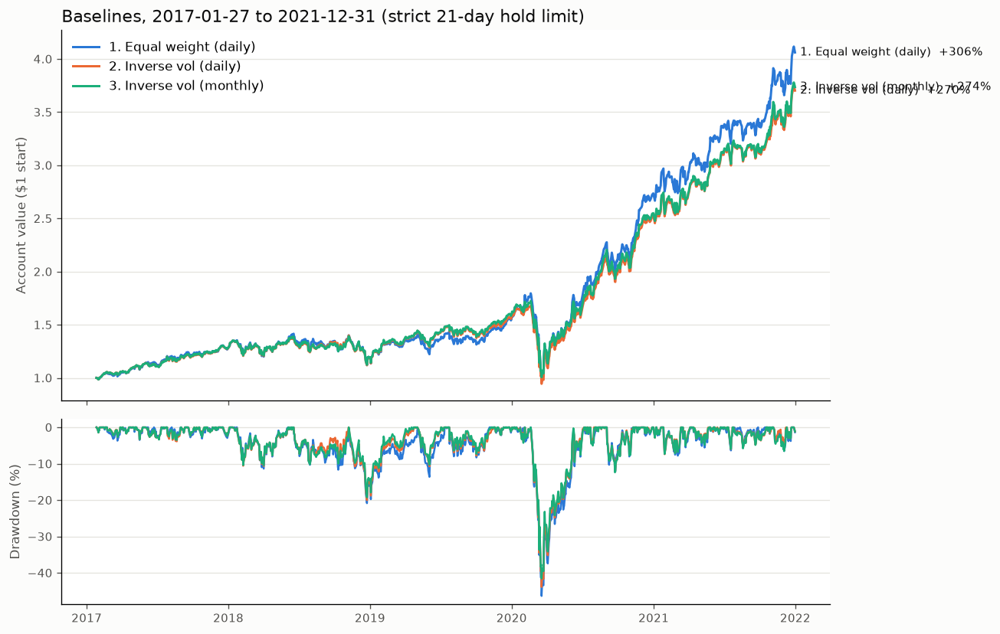

# Baselines, Explained

Script: `research/baselines.py`. Run it with `.venv/bin/python research/baselines.py`.
Chart: `research/baselines.png`.
Period: **2017-01-27 to 2021-12-31** (development data only; 2022–23 is never loaded).

---

## 1. The three baselines

| # | Name | What it holds | How often it trades |
|---|---|---|---|
| 1 | Equal weight (daily) | 1/6 of the account in each asset | Every day it trades back to exactly 1/6 each |
| 2 | Inverse vol (daily) | More money in calmer assets, less in jumpier ones | Every day it trades to fresh weights |
| 3 | Inverse vol (monthly) | Same weights as #2 | Sets weights once, then leaves them alone for 21 trading days |

**Inverse volatility, in plain words:** volatility is how much an asset's price
jumps around from day to day. For each asset we measure it over the past 60
days, then give each asset a weight proportional to `1 / volatility`. An asset
that's half as jumpy gets twice the money. The goal is for each asset to add
about the same amount of risk.

All three are long only and fully invested (weights add up to 100%).

**Why start on 2017-01-27?** Inverse vol needs 60 days of history before it can
make its first decision, and the data starts 2016-10-28. All three strategies
start on the same day so the comparison is fair.

---

## 2. Results (main table: strict 21-day hold limit)

This uses the backtester's current rule: once a position has been held 21
trading days, sell it, sit out one day, then buy it back.

| | 1. Equal weight (daily) | 2. Inverse vol (daily) | 3. Inverse vol (monthly) |
|---|---|---|---|
| Total return | **306.1%** | 270.2% | 273.6% |
| Annualized return | **32.9%** | 30.4% | 30.7% |
| Annualized volatility | 26.9% | **25.0%** | 25.1% |
| Sharpe ratio | 1.19 | 1.19 | 1.19 |
| Max drawdown | −46.4% | −43.9% | **−41.6%** |
| Turnover per year | 26.1x | 27.7x | **23.1x** |
| Total costs paid | 6.44% | 6.82% | **5.70%** |
| Forced closes | 336 | 336 | 0 |

"Forced closes" counts the times the backtester had to close a position for
the strategy. Strategy #3 handles the 21-day exit itself, so it has none.
#1 and #2 do the same round trip, but the backtester forces it on them.

### Same thing with the hold limit turned off (for comparison only)

| | 1. Equal weight (daily) | 2. Inverse vol (daily) | 3. Inverse vol (monthly) |
|---|---|---|---|
| Total return | 317.9% | 287.6% | 287.2% |
| Sharpe ratio | 1.20 | 1.21 | 1.21 |
| Max drawdown | −46.5% | −44.7% | −44.7% |
| Turnover per year | 3.7x | 5.4x | 5.3x |
| Total costs paid | 0.92% | 1.33% | 1.31% |

Here, #3 trades straight to fresh weights every 21 days, with no sell-and-sit-out.

### What inverse vol actually did with the weights

| Asset | Equal weight | Inverse vol (average) | Inverse vol (lowest) | Inverse vol (highest) |
|---|---|---|---|---|
| Asset_A | 16.7% | 19.0% | 13.5% | 29.6% |
| Asset_B | 16.7% | 15.4% | 7.8% | 22.9% |
| Asset_C | 16.7% | 17.1% | 8.7% | 24.3% |
| Asset_D | 16.7% | **9.4%** | 5.1% | 15.2% |
| Asset_E | 16.7% | **22.5%** | 13.0% | 34.3% |
| Asset_F | 16.7% | 16.6% | 9.7% | 24.6% |

Asset_D is the jumpiest, so it gets about half the equal weight. Asset_E is the
calmest, so it gets the most.

---

## 3. What this tells us

1. **All three have the same Sharpe (about 1.19–1.21).** Inverse vol lowers
   risk, but it lowers return by about the same amount, so return per unit of
   risk doesn't improve. In this data the jumpy asset (D) also earned its keep.
2. **Inverse vol does shrink the drawdown a bit:** −44% vs −46%. That counts
   in the scoring. But all three still lost over 40% in the March 2020 crash.
   That's the main thing to beat: none of these baselines has any defence
   against a market-wide crash, because every asset falls together.
3. **#3's better drawdown (−41.6%) is probably partly luck.** Its day out of
   the market falls on a fixed schedule, and that schedule happened to help
   during 2020. With the hold limit off, #2 and #3 have identical drawdowns. Don't read too much into the 2-point gap.
4. **The hold-limit rule costs about 5% over five years.** All the sell-and-rebuy
   round trips push turnover from about 4x to 25x a year. That's the biggest
   unknown left: it would help to find out what the competition actually requires
   (see section 9 of `backtest_explained.md`).
5. **Rebalancing daily vs monthly hardly matters** for return or risk. Monthly
   trades a bit less, so it pays a bit less in costs.

**Baseline to beat:** Sharpe ≈ 1.2, max drawdown ≈ −44%. A good next strategy
should mainly improve the drawdown, for example by cutting exposure when
volatility spikes, while keeping Sharpe at or above 1.2.

---

## 4. Look-ahead check

The script reruns strategy #2 with every row from 2019-07-18 onward deleted.
The weights it picked on each day up to that date came out identical. So
the strategy never used data it shouldn't have had. Volatility is measured only
from closes up to yesterday, and trades happen at today's open.
