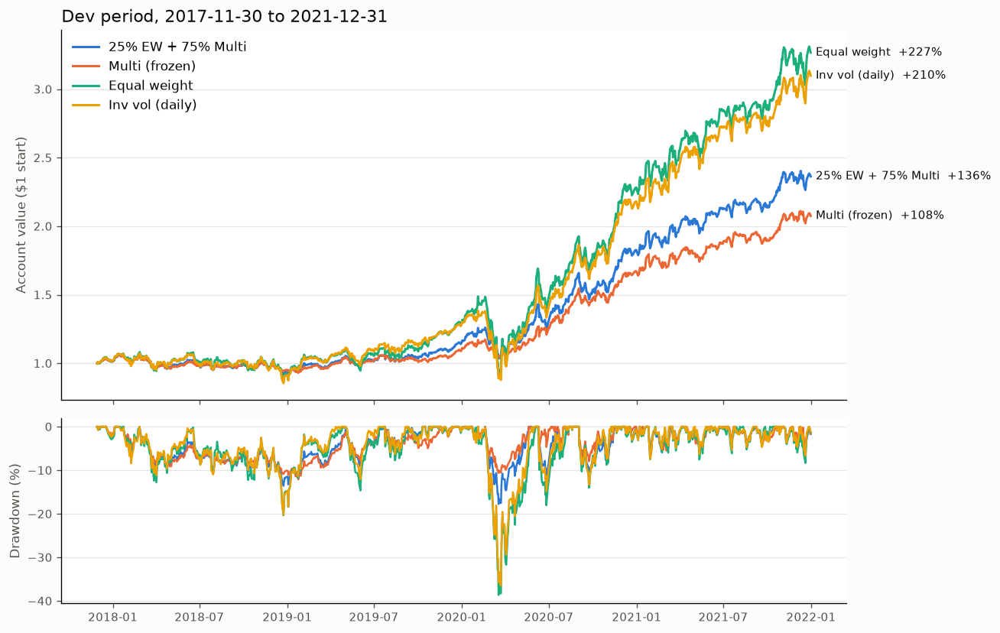
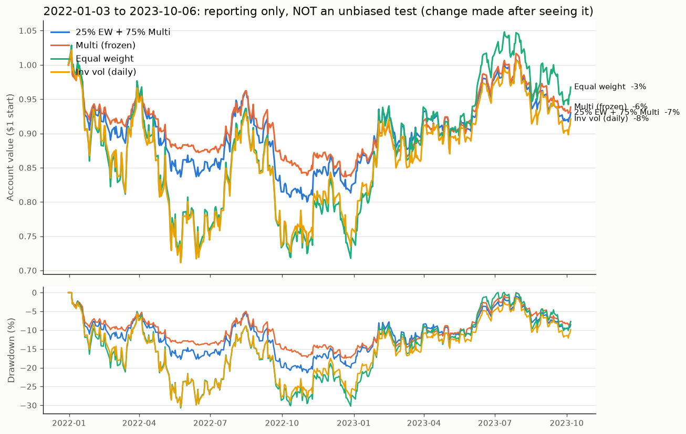

# Final Change: 25% Equal Weight + 75% Multi

Script: `research/final_change.py`. Run it with `.venv/bin/python research/final_change.py`.
Charts: `research/final_change_dev.png`, `research/final_change_holdout.png`.

**The change:** each day, the target weight for each asset is

    0.25 × (1/6)  +  0.75 × (frozen Multi weight)

So a quarter of the account is always invested equally in all six assets, and the
other three quarters follow the Multi strategy, unchanged.

**Why (as stated before running):** in the dev period, Multi was slow to
buy back in after a fall (it lagged in 2019 and 2021). The scoring also rewards
return, not just drawdown. An always-invested slice catches some of each
rebound.

> ⚠️ **This change was decided after the 2022–23 holdout had been seen.**
> Even though the reason comes from dev-period evidence, knowing the holdout
> result (Multi missed the 2023 rebound) could have shaped the choice. **The
> 2022–23 numbers below are for reporting only. They are not an unbiased test.**
> No other variations were tried.

---

## 1. Dev period check (2017-11-30 to 2021-12-31)

Same start date as `final_signal_explained.md`, so the Multi numbers match that file.

| | **25% EW + 75% Multi** | Multi (frozen) | Equal weight | Inv vol (daily) |
|---|---|---|---|---|
| Annualized return | **23.4%** | 19.6% | 33.6% | 31.9% |
| Annualized volatility | 17.0% | 13.8% | 28.8% | 26.7% |
| **Sharpe ratio** | **1.32** | 1.37 | 1.15 | 1.17 |
| **Max drawdown** | **−17.8%** | −12.1% | −38.6% | −36.5% |
| Calmar | 1.32 | 1.62 | 0.87 | 0.87 |
| Turnover per year | 28.2x | 28.9x | 26.3x | 27.7x |
| Total costs paid | 5.76% | 5.91% | 5.37% | 5.66% |
| Avg % invested | 71% | 63% | 96% | 96% |
| COVID crash (Feb 19–Mar 23 2020) | −17.5% | −10.5% | −38.2% | −36.4% |

**Against your expected numbers:**

| | Expected | Actual | Verdict |
|---|---|---|---|
| Sharpe | ~1.4 | **1.32** | Roughly matches, slightly lower |
| Max drawdown | ~−21% | **−17.8%** | Roughly matches, a bit better than expected |

### Year by year, dev period (Return / Sharpe / Max DD)

| Year | 25% EW + 75% Multi | Multi (frozen) | Equal weight |
|---|---|---|---|
| 2017 (Dec only) | +1.2% / 1.92 / −2.3% | +1.1% / 1.88 / −2.0% | +1.4% / 1.85 / −2.9% |
| 2018 | −7.2% / −0.52 / −13.6% | −5.8% / −0.53 / −10.9% | −9.1% / −0.32 / −20.4% |
| 2019 | **+22.1% / 1.78** / −8.5% | +14.9% / 1.47 / −6.6% | +39.9% / 1.93 / −14.6% |
| 2020 | +59.4% / 2.00 / −17.8% | +52.9% / 2.32 / −10.6% | +77.1% / 1.48 / −38.6% |
| 2021 | **+29.4% / 1.68** / −6.3% | +24.1% / 1.59 / −5.7% | +43.1% / 1.75 / −8.3% |

### What the dev period says

- **It fixes what it was meant to fix.** In the two slow-re-entry years, the
  blend earned noticeably more: 2019 +22% vs +15%, and 2021 +29% vs +24%.
  Sharpe improved in both years too.
- **But it isn't free.** In the sell-offs it loses more: COVID −17.5% vs
  −10.5%, and 2018 −7.2% vs −5.8%. That's simply because a quarter of the account
  never steps aside.
- **Overall it's a trade-off, not an upgrade.** You get +3.8% a year more
  return. In exchange, Sharpe dips slightly (1.32 vs 1.37) and the worst drawdown
  gets 5.7 points deeper (−17.8% vs −12.1%). Whether that's better depends on how
  the competition weights return against drawdown and Sharpe. If Sharpe and
  drawdown dominate the score, as `CLAUDE.md` says they do, then by dev-period
  evidence alone, plain Multi is at least as good.

---

## 2. 2022–23 rerun: REPORTING ONLY, NOT AN UNBIASED TEST

| 2022-01-03 to 2023-10-06 | **25% EW + 75% Multi** | Multi (frozen) | Equal weight | Inv vol (daily) |
|---|---|---|---|---|
| Total return | −7.0% | −6.2% | **−3.3%** | −7.9% |
| Annualized return | −4.0% | −3.6% | **−1.9%** | −4.6% |
| Annualized volatility | 16.2% | **12.4%** | 30.9% | 29.0% |
| Sharpe ratio | −0.17 | −0.23 | **0.09** | −0.02 |
| Max drawdown | −21.4% | **−17.4%** | −30.7% | −30.4% |
| Avg % invested | 58% | 46% | 95% | 95% |

| | 2022 return | 2022 max DD | 2023 (to Oct 6) return |
|---|---|---|---|
| **25% EW + 75% Multi** | −17.5% | −21.4% | +12.7% |
| Multi (frozen) | **−15.7%** | **−17.4%** | +11.3% |
| Equal weight | −25.3% | −30.7% | **+29.5%** |
| Inv vol (daily) | −23.9% | −30.4% | +21.1% |

### What happened

- **Even on the period that prompted it, the change didn't help.** Total return
  was a bit worse (−7.0% vs −6.2%), and the worst drawdown was 4 points deeper.
  It recovered only slightly more in 2023 (+12.7% vs +11.3%).
- **Why it caught so little of the 2023 rebound:** only a quarter of the account
  is always invested. A quarter of equal weight's +29.5% is about +7%, which
  isn't enough to close the gap.
- **It also did about 2.3 points worse than a simple 25/75 mix of the two
  strategies' daily returns** (−7.0% vs −4.6%). The cause is the 21-day hold
  rule. Because the equal-weight slice never goes to zero, every asset's
  position ages without a break. So the backtester force-closes the *whole*
  position, including the Multi part, every 21 days, and sits out a day.
  In 2022–23 those fixed sit-out days happened to fall on up days. In the dev
  period, the same effect was close to zero (+136.3% vs +136.2%). So this is
  bad luck in the exit schedule, the same kind we saw in the baselines, rather
  than a flaw in the idea. It does show again how much the hold-limit rule's
  interpretation matters.

### Honest summary

The blend works as intended in the dev period: more return in rebound years,
paid for with deeper drawdowns in sell-offs. It's a sideways move on
risk-adjusted terms (Sharpe 1.32 vs 1.37), not a clear improvement. On 2022–23,
which is no longer an unbiased test, it did slightly worse than plain Multi.

Both versions are reasonable final choices. Here's how to choose:

| If the competition score… | Then prefer |
|---|---|
| Weights Sharpe and drawdown most heavily (as `CLAUDE.md` says) | **Multi (frozen)**: lower drawdown, equal or better Sharpe |
| Gives return a meaningful share of the points | **25% EW + 75% Multi**: about 4% a year more return in normal markets |

Whichever you pick, a realistic expectation for unseen data is a Sharpe of about
1.0–1.4 and a drawdown of about −15% to −25%. It will trail buy-and-hold in
strong rebounds. Neither version has a clean, unbiased out-of-sample test
anymore.

---

## 3. Checks

- **Look-ahead check passed:** deleting every dev row from 2019-12-17 onward did
  not change any earlier day's weights.
- **Multi is unchanged:** it's imported directly from `final_signal.py`, and its dev
  numbers here (Sharpe 1.37, max drawdown −12.1%) match `final_signal_explained.md` exactly.
