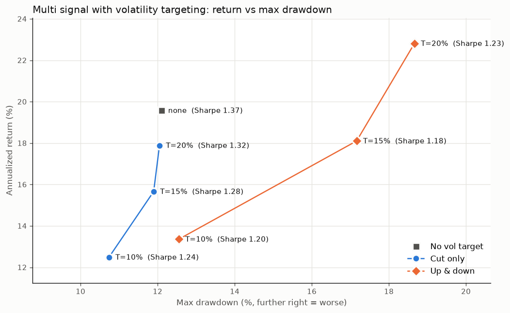
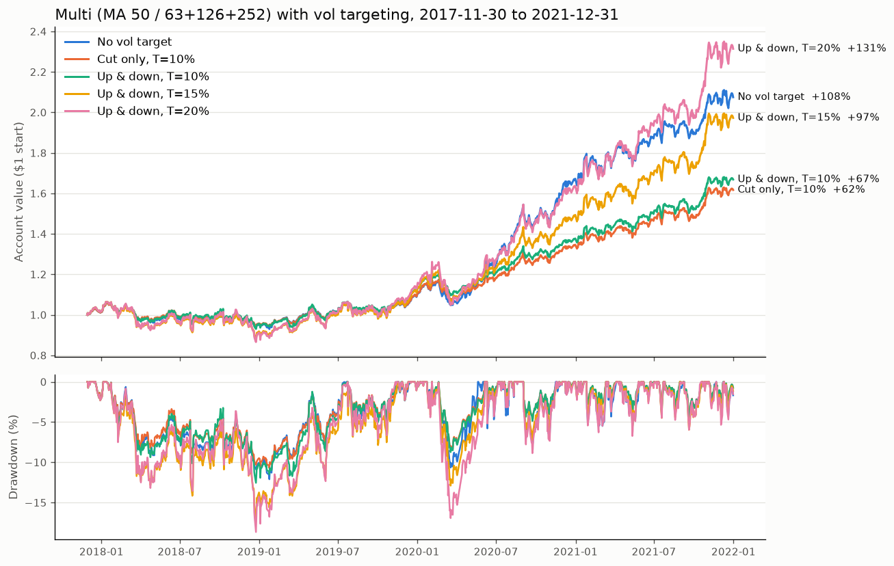

# Final Signal Choice + Volatility Targeting

Script: `research/final_signal.py`. Run it with `.venv/bin/python research/final_signal.py` (about 35 seconds).
Charts: `research/final_vol_target.png`, `research/final_vol_target_equity.png`.
Period: **2017-11-30 to 2021-12-31** (development data only; 2022–23 never loaded).

**Short answer:**
- **Final signal: Multi** (50-day trend + the average of 63/126/252-day momentum).
  It had a lower Sharpe at its exact settings, but it holds up better when the
  settings change, and the decision rule fixed in advance picked it.
- **Volatility targeting: don't add it.** No version of it improved Sharpe, and
  the one that cut drawdown a little gave up over a third of the return.

---

## 1. The two versions (fixed in advance)

| | Signal per asset | Possible values |
|---|---|---|
| **Single** | (trend 50 + momentum 126) ÷ 2 | 0, ½, 1 |
| **Multi** | (trend 50 + average of momentum 63, 126, 252) ÷ 2 | 0, ⅙, ⅓, ½, ⅔, ⅚, 1 |

Weight = inverse-vol weight × signal, and the rest stays in cash. Multi steps in
and out more gradually, because four separate signals each move a slice of the
position.

**Why the start date is 2017-11-30:** the robustness test below shifts the
252-day lookback to 273 days, which needs 273 days of history. Every run here
starts on that same day. So the numbers differ a bit from earlier files, which
started earlier.

**Decision rule (written into the script before running):** test each version
at 9 nearby settings (MA 30/50/100 × lookbacks shifted −21/0/+21 days). The
winner is better on **both** median Sharpe and worst max drawdown. If the two
disagree, the version whose Sharpe varies less across settings wins.

---

## 2. Head to head (at the chosen settings)

| | Inv-vol baseline | Single | Multi |
|---|---|---|---|
| Annualized return | 31.9% | **22.5%** | 19.6% |
| Annualized volatility | 26.7% | 14.1% | **13.8%** |
| Sharpe ratio | 1.17 | **1.51** | 1.37 |
| Max drawdown | −36.5% | **−10.0%** | −12.1% |
| Turnover per year | 27.7x | 28.3x | 28.9x |
| Total costs paid | 5.66% | 5.78% | 5.91% |
| Avg % invested | 95% | 63% | 63% |

At its own exact settings, **Single looks better**. But we already know from
`robustness_explained.md` that 126 days happened to be an unusually lucky
setting in this data. The real question is which one holds up when the settings
move.

### Year by year (Return / Sharpe / Max DD)

| Year | Single | Multi | Baseline |
|---|---|---|---|
| 2017 (Dec only) | +1.3% / 2.25 / −1.9% | +1.1% / 1.88 / −2.0% | +1.6% / 2.34 / −2.4% |
| 2018 | −2.1% / −0.16 / −8.2% | −5.8% / −0.53 / −10.9% | −10.4% / −0.43 / −20.2% |
| 2019 | +14.5% / 1.39 / −6.6% | **+14.9% / 1.47** / −6.6% | +40.4% / 2.10 / −12.0% |
| 2020 | **+67.5% / 2.75 / −10.0%** | +52.9% / 2.32 / −10.6% | +70.7% / 1.47 / −36.5% |
| 2021 | +20.2% / 1.33 / −7.3% | **+24.1% / 1.59 / −5.7%** | +42.0% / 1.87 / −7.4% |

Single's lead comes from 2018 and 2020, the two sell-offs, where 126 days
happened to be the right speed. Multi wins 2019 and 2021. Neither one wins
every year.

---

## 3. The robustness test (this decided it)

Sharpe at each of the 9 nearby settings:

| Single | lookback −21 (105) | **126** | +21 (147) |
|---|---|---|---|
| MA 30 | 1.25 | 1.66 | 1.62 |
| MA 50 | 1.17 | **1.51** | 1.51 |
| MA 100 | 1.15 | 1.45 | 1.48 |

| Multi | −21 (42/105/231) | **63/126/252** | +21 (84/147/273) |
|---|---|---|---|
| MA 30 | 1.38 | 1.49 | 1.45 |
| MA 50 | 1.26 | **1.37** | 1.30 |
| MA 100 | 1.27 | 1.22 | 1.26 |

| Across the 9 settings | Single | Multi | Better |
|---|---|---|---|
| Median Sharpe | **1.48** | 1.30 | Single |
| Lowest Sharpe | 1.15 | **1.22** | Multi |
| Sharpe range (max − min) | 0.51 | **0.27** | Multi |
| **Worst** max drawdown | −17.2% | **−16.2%** | Multi |
| Median max drawdown | −13.6% | **−13.1%** | Multi |

**Result: a split decision → the smaller Sharpe range wins → Multi.**

### Why Multi is the more robust choice

- **Single falls off a cliff if you move it one step.** Shorten the lookback from
  126 to 105 days and its Sharpe drops from about 1.5 to about 1.2, close to the
  baseline. Your real result depends on whether 126 happens to suit the
  next two years, and nothing tells us it will.
- **Multi's results stay flat.** Its worst nearby setting (1.22) beats Single's
  worst (1.15), and the spread is half as wide. Because it blends three
  lookbacks, a single unlucky window can only do a third of the damage.
- **Multi's lower Sharpe here is the more honest number.** Last time's estimate
  of "about 1.3 on new data" fits Multi's 1.30 median. Single's 1.51 is
  probably the lucky version of that same ~1.3.
- **The cost of choosing Multi is small:** about 3% a year less return and 2 points
  more drawdown at the exact settings. Those differences are smaller than what
  luck alone could produce over a few years.

**The trade-off, stated plainly:** if 126 days really is special for these
assets, Single would have been better. We're giving up that possible upside to
avoid betting everything on one setting that might have been lucky. Given the
competition rewards steady Sharpe and low drawdown, that trade is worth it.

---

## 4. Volatility targeting on Multi

**What it does:** each day, estimate how jumpy the whole portfolio has been over
the last 20 days. If it's jumpier than the target T, shrink every position.
That's the "cut only" variant. The "up & down" variant can also grow positions
when things are calm, but never beyond 100% of the account.

| | No vol target | Cut only 10% | Cut only 15% | Cut only 20% | Up & down 10% | Up & down 15% | Up & down 20% |
|---|---|---|---|---|---|---|---|
| Annualized return | **19.6%** | 12.5% | 15.7% | 17.9% | 13.4% | 18.1% | 22.8% |
| Max drawdown | −12.1% | **−10.7%** | −11.9% | −12.0% | −12.5% | −17.2% | −18.7% |
| **Sharpe ratio** | **1.37** | 1.24 | 1.28 | 1.32 | 1.20 | 1.18 | 1.23 |
| Calmar | **1.62** | 1.16 | 1.32 | 1.48 | 1.06 | 1.05 | 1.22 |
| Annualized volatility | 13.8% | 9.9% | 12.0% | 13.1% | 11.0% | 15.1% | 18.1% |
| Avg % invested | 63% | 49% | 57% | 61% | 54% | 72% | 83% |
| COVID crash (Feb 19–Mar 23) | −10.5% | −8.3% | −10.4% | −10.5% | −8.5% | −12.5% | −16.4% |
| Total costs paid | 5.91% | 5.01% | 5.69% | 5.88% | 6.06% | 8.06% | 9.34% |

### What happened

- **Every vol-target version has a lower Sharpe than no vol target.** The
  "no vol target" point sits above and to the left of every other point on
  the scatter: the most return for its drawdown.
- **"Cut only, 10%" is the only one that reduces drawdown**, and only from
  −12.1% to −10.7%. It costs 7% a year in return (19.6% → 12.5%), which is a bad trade.
- **"Up & down" makes things worse.** When the trend/momentum signals have
  already moved part of the account to cash, scaling up puts more money into
  the few assets still "on." That concentrates risk, and the drawdown grows to −17% to −19%.
  The worst point was around Q4 2018, not COVID.
- **"Cut only, 20%" barely does anything.** The strategy's volatility is already
  about 14%, so a 20% target rarely kicks in.

### Why it doesn't help *this* strategy

Vol targeting usually helps a fully invested portfolio like the baseline. Our
strategy already de-risks itself: when assets fall, the signals switch them
off and the money goes to cash. Adding vol targeting on top is like having two
people hitting the brakes. It also reacts at the wrong time. Volatility
stays high for weeks *after* a crash, so it keeps exposure low during the
rebound. In 2020, "cut only 10%" made +23% while no vol target made +53%,
because it sat out most of the recovery.

---

## 5. Final choice

**Multi signal, no volatility targeting:**
- 50-day trend filter + the average of 63/126/252-day momentum, each per asset
- Weight = inverse-vol weight × (trend + momentum average) ÷ 2, and the rest is cash
- On 2017-11-30 to 2021-12-31: Sharpe 1.37, max drawdown −12.1%, 19.6% a year
  (baseline: 1.17, −36.5%, 31.9%)

Realistic expectation for new data: Sharpe about 1.2–1.4, drawdown around −12% to −18%,
and lagging the baseline in strong bull years.

---

## 6. Checks (all passed)

1. **Same as before:** the new code's Single version gives exactly the same
   weights as the earlier AVERAGE strategy from `signals.py`.
2. **No look-ahead:** for Multi and Multi + vol target, deleting every row from
   2019-12-17 onward didn't change any earlier day's weights.
3. **Tamper test:** tripling all prices from the decision day onward didn't
   change that day's weights. Vol targeting uses only returns up to yesterday.
