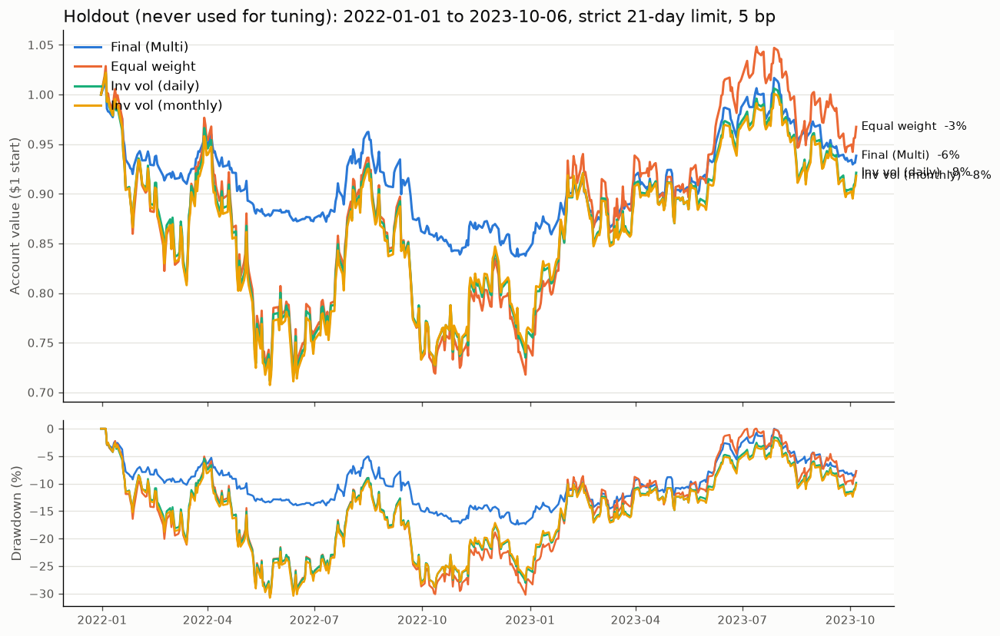

# Holdout Test: 2022-01-03 to 2023-10-06

Script: `research/holdout.py`. Run it with `.venv/bin/python research/holdout.py`.
Chart: `research/holdout.png`.

This is the **one-time** test on data that was never used for any decision.
The strategy was frozen beforehand and **nothing is changed based on this result.**

**Frozen strategy** (imported unchanged from `final_signal.py`):
- Signal per asset = (50-day trend + the average of 63/126/252-day momentum) ÷ 2
- Weight = inverse-vol weight × signal, and the rest stays in cash. No volatility targeting.
- Strict 21-day hold limit, 5 bp costs per side, trades at the next day's open.

Every strategy starts in cash and makes its first trade at the open on
2022-01-03, using data only up to 2021-12-31. (Older data is used to warm up
the signals. That's the past, so it's allowed.)

---

## Short answer

**Mixed, and worse than expected.**
- ✅ **Drawdown protection worked:** a worst loss of **−17.4%**, compared with
  about **−30.5%** for the baselines. That's close to half, and inside the predicted range (−12% to −18%).
- ❌ **Return and Sharpe failed:** it **lost 6.2%** over the period. Its Sharpe of
  **−0.23** is the worst of the four. The expected Sharpe was 1.2–1.4.
- It lost less in 2022, then **missed most of the 2023 rebound**, and ended up behind the baselines.

---

## 1. Full holdout (2022-01-03 to 2023-10-06, about 21 months)

| | **Final (Multi)** | Equal weight | Inv vol (daily) | Inv vol (monthly) |
|---|---|---|---|---|
| Total return | −6.2% | **−3.3%** | −7.9% | −8.2% |
| Annualized return | −3.6% | **−1.9%** | −4.6% | −4.7% |
| Annualized volatility | **12.4%** | 30.9% | 29.0% | 28.8% |
| Sharpe ratio | −0.23 | **0.09** | −0.02 | −0.02 |
| **Max drawdown** | **−17.4%** | −30.7% | −30.4% | −30.8% |
| Calmar | −0.20 | **−0.06** | −0.15 | −0.15 |
| Turnover per year | 24.2x | 27.0x | 28.1x | 23.9x |
| Total costs paid | 2.13% | 2.37% | 2.47% | 2.10% |
| Avg % invested | 46% | 95% | 95% | 95% |

## 2. 2022 only (the bear market)

| | Return | Sharpe | Max drawdown |
|---|---|---|---|
| **Final (Multi)** | **−15.7%** | −1.36 | **−17.4%** |
| Equal weight | −25.3% | −0.62 | −30.7% |
| Inv vol (daily) | −23.9% | −0.62 | −30.4% |
| Inv vol (monthly) | −23.5% | −0.61 | −30.8% |

**About the Sharpe here:** when returns are negative, *lower* volatility makes
the Sharpe *more* negative. Final lost much less money than the baselines
(−15.7% vs about −24%), but its Sharpe looks worse because it moved around less.
In a losing year, Sharpe is a confusing measure. The return and drawdown columns
tell the real story: **Final lost about a third less.**

## 3. 2023 (to Oct 6, the rebound)

| | Return | Sharpe | Max drawdown |
|---|---|---|---|
| **Final (Multi)** | +11.3% | 1.18 | **−8.6%** |
| Equal weight | **+29.5%** | **1.68** | −10.1% |
| Inv vol (daily) | +21.1% | 1.41 | −10.7% |
| Inv vol (monthly) | +20.0% | 1.34 | −10.5% |

## 4. Quarter by quarter

| Quarter | Final | Equal weight | Inv vol (daily) | Final: avg % invested |
|---|---|---|---|---|
| 2022 Q1 | −5.0% | −4.6% | −5.4% | 35% |
| 2022 Q2 | **−8.2%** | −21.5% | −21.3% | 15% |
| 2022 Q3 | −1.1% | −2.1% | −1.2% | 51% |
| 2022 Q4 | −2.3% | +1.9% | +3.4% | 35% |
| 2023 Q1 | +8.9% | **+25.6%** | +19.7% | 58% |
| 2023 Q2 | +7.6% | +8.2% | +6.8% | 70% |
| 2023 Q3 | −5.5% | −6.7% | −7.1% | 57% |
| 2023 Q4 (6 days) | +0.6% | +2.1% | +1.9% | 28% |

How the six assets themselves moved (context only):

| Asset | 2022 | 2023 to Oct 6 | Worst drop over the holdout | Final's avg weight 2022 → 2023 |
|---|---|---|---|---|
| A | −27% | +37% | −31% | 10% → 16% |
| B | −5% | −2% | −49% | 5% → 13% |
| C | **−64%** | **+162%** | −74% | 1% → 10% |
| D | **−65%** | **+112%** | −73% | 4% → 5% |
| E | −15% | −6% | −40% | 8% → 13% |
| F | −44% | +3% | −57% | 5% → 5% |

---

## 5. What happened, honestly

### What worked
- **It stepped aside in the big Q2 2022 drop.** The baselines lost about 21% that
  quarter. Final lost 8%, because by mid-May it was only about 5% invested. Its
  worst point was about −17% in late 2022 / early 2023, against about −30% for
  everyone else.
- **It barely held C and D during their crashes of about −65%** (1% and 4% average
  weight in 2022). The signals switched them off, exactly as designed.
- **Drawdown came in within the predicted range.** The dev-period estimate was
  −12% to −18%, and the holdout gave −17.4%.

### What didn't work
1. **It still lost 15.7% in 2022, despite being mostly in cash.** Two reasons:
   - **It started 2022 partly invested, and the first drops came fast.** In April
     and early May it was still 20–40% invested, and the assets it held were
     falling up to about 7% in a single day. The signals react to *yesterday's*
     close, so they're always a step behind a fast drop.
   - **Whipsaws from bear-market rallies.** In summer and late 2022, prices
     bounced. That turned the 50-day trend (and some short momentum) back on,
     the strategy bought, and then prices fell again. You can see this
     in Q3–Q4 2022: Final was 35–51% invested and lost money while the
     baselines were roughly flat.
2. **It missed most of the 2023 rebound.** C and D more than doubled in 2023,
   but Final held only about 10% and 5% of them on average. Two things held
   it back:
   - The 252-day momentum stayed negative for months, because the price was
     still below where it had been a year earlier.
   - Inverse-vol weighting gives jumpy assets small weights anyway.

   This is the slow-re-entry weakness we saw in the dev period (2019, 2021), but
   much bigger here, because the 2022 crash was so deep that the recovery
   started from far below.
3. **So it ended up behind the baselines overall.** Equal weight dropped
   further, but its 2023 rally (+29.5%) left it at −3.3% vs Final's −6.2%.

### Was this bad luck, or was the strategy over-rated?

Probably both:
- **This period is hard for trend-following.** First came a choppy decline full
  of sharp rallies, then a fast V-shaped rebound. Signals based on past prices do
  badly in exactly that kind of market.
- **Noise is large over 21 months.** A Sharpe ratio measured over 1.75 years has a margin
  of error of roughly ±0.75. Getting −0.23 against an expected ~1.3 is about two
  margins of error below. That's a real disappointment, more than bad luck alone
  would usually explain.
- **The dev period flattered the idea.** As `robustness_explained.md` showed, most
  of the dev-period Sharpe advantage came from one fast crash (COVID), which
  happens to be the easiest case for this kind of strategy. 2022 was a slow,
  choppy bear market, which is the hard case.

### The honest one-line summary

**The strategy did what it claimed, cutting the worst loss nearly in half. But
that protection was not free: it gave up the rebound, and over this particular
21 months it cost more in missed gains than it saved in losses.**

---

## 6. What this means for the competition

- Scoring is relative and weighted across return, drawdown and Sharpe. On this
  holdout, Final would score **well on drawdown** and **poorly on return and
  Sharpe** compared with buy-and-hold competitors.
- **Nothing has been changed because of this result.** It's tempting to now try
  "Single instead of Multi" or "shorter momentum" on 2022–23 to see what would
  have done better. That would turn the holdout into tuning data, and we'd lose
  our only honest estimate of how the strategy does on unseen data.
  I deliberately didn't run any alternatives here.
- **The holdout is now used up.** If you change the strategy later, the reason
  must come from first principles or dev-period evidence (for example, "re-entry
  is too slow," which the dev period already showed in 2019 and 2021). And
  2022–23 can no longer give an unbiased check of the changed version.

---

## 7. Checks

- **Look-ahead check passed:** deleting every row from 2022-11-17 onward did not
  change any earlier day's weights.
- **Same strategy as the dev period:** the strategy function is imported
  directly from `final_signal.py`, with the same settings (MA 50, lookbacks
  63/126/252, no vol target).
