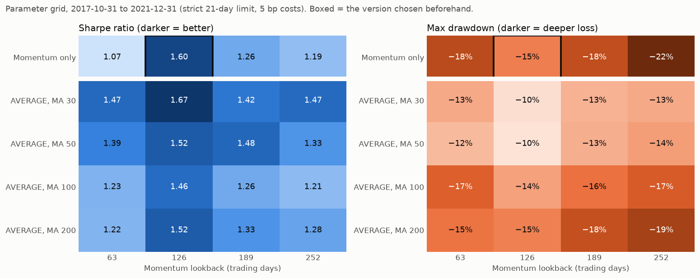
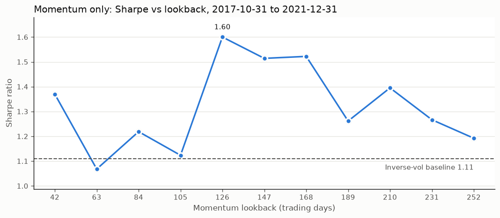

# Is the Momentum Strategy Robust or Overfit?

Script: `research/robustness.py`. Run it with `.venv/bin/python research/robustness.py` (about 40 seconds).
Charts: `research/robustness_heatmaps.png`, `research/robustness_sweep.png`.
Development data only (2016–2021). The 2022–23 holdout is never loaded.

**Short answer:** the **drawdown protection is robust**. The **Sharpe improvement
is partly luck**: it depends on the 126-day setting and on one event, the
COVID crash. Expect a Sharpe of roughly **1.3**, not 1.6, on new data. And the
**AVERAGE** version (trend + momentum) turns out to be more stable than Momentum only.

---

## 1. Why the grid has two parts

The **Momentum only** strategy doesn't use a moving average at all, so changing
the MA length can't change its results. Its grid is just one row: four lookbacks.
To test the MA lengths too, the 4×4 grid uses the **AVERAGE** strategy, which
uses both signals.

Every cell starts on **2017-10-31**, because the 252-day lookback needs a year
of history first. That's why some numbers differ a little from
`signals_explained.md`, which starts in May 2017. Over this period the
inverse-vol baseline has **Sharpe 1.11, max drawdown −48%**.

### Sharpe ratio (higher is better; baseline 1.11)

| | 63 days | 126 days | 189 days | 252 days |
|---|---|---|---|---|
| **Momentum only** | 1.07 | **1.60** ← chosen | 1.26 | 1.19 |
| AVERAGE, MA 30 | 1.47 | 1.67 | 1.42 | 1.47 |
| AVERAGE, MA 50 | 1.39 | 1.52 | 1.48 | 1.33 |
| AVERAGE, MA 100 | 1.23 | 1.46 | 1.26 | 1.21 |
| AVERAGE, MA 200 | 1.22 | 1.52 | 1.33 | 1.28 |

### Max drawdown (smaller is better; baseline −48%)

| | 63 days | 126 days | 189 days | 252 days |
|---|---|---|---|---|
| **Momentum only** | −18.4% | **−15.0%** ← chosen | −18.1% | −21.8% |
| AVERAGE, MA 30 | −13.1% | −10.2% | −12.7% | −13.1% |
| AVERAGE, MA 50 | −12.2% | −10.0% | −12.8% | −13.7% |
| AVERAGE, MA 100 | −16.6% | −13.6% | −15.5% | −16.9% |
| AVERAGE, MA 200 | −15.4% | −15.0% | −17.8% | −19.3% |

### Annualized return (baseline about 30%)

| | 63 days | 126 days | 189 days | 252 days |
|---|---|---|---|---|
| **Momentum only** | 15.9% | **26.5%** | 20.7% | 19.8% |
| AVERAGE, MA 30 | 20.8% | 24.8% | 20.6% | 21.6% |
| AVERAGE, MA 50 | 20.0% | 22.4% | 21.8% | 19.5% |
| AVERAGE, MA 100 | 18.1% | 22.3% | 18.9% | 18.1% |
| AVERAGE, MA 200 | 18.3% | 24.2% | 21.0% | 20.2% |

### What the grid says

- **Good sign:** all 20 cells beat the baseline's drawdown by a wide margin
  (−10% to −22% vs −48%). That part of the result doesn't depend on picking the
  right settings.
- **Warning sign:** for Momentum only, the Sharpe is **1.60 at 126 days but
  only 1.07–1.26 at the other three lookbacks**. That's barely above the 1.11
  baseline. A real effect would usually look like a smooth hill, not a
  single spike.
- **The 126-day column is strong in every row.** That suggests something
  about this particular 5-year stretch made 6-month momentum work well, rather
  than a code bug. Still, it's one stretch of history, so it's not a reason to
  trust 126 more.
- **AVERAGE is flatter, and flatter means more robust.** Across all 16 cells, its
  Sharpe is 1.21–1.67 and every cell beats the baseline. The MA 50 row is
  especially steady (1.33–1.52). Combining two signals means that if one is
  "unlucky," the other partly makes up for it.
- **Don't pick the grid's top cell (MA 30 / 126, Sharpe 1.67).** Choosing the
  best of 20 tries is exactly how you overfit. The cell you'd choose
  before looking is what counts.

---

## 2. Finer lookback sweep (Momentum only)

| Lookback | 42 | 63 | 84 | 105 | **126** | 147 | 168 | 189 | 210 | 231 | 252 |
|---|---|---|---|---|---|---|---|---|---|---|---|
| Sharpe | 1.37 | 1.07 | 1.22 | 1.12 | **1.60** | 1.51 | 1.52 | 1.26 | 1.40 | 1.27 | 1.19 |
| Max DD | −15% | −18% | −17% | −17% | **−15%** | −15% | −14% | −18% | −18% | −19% | −22% |

The picture is a bit better than the 4-point grid. 126–168 days form a small
plateau (around 1.5–1.6), not a single spike. But the line jumps around a lot,
for example 1.12 at 105 days and then 1.60 at 126. **The average across all 11
lookbacks is about 1.32**, which is a more honest estimate of what this idea
really delivers than 1.60.

---

## 3. Costs: 5 bp vs 10 bp vs 20 bp (Momentum only, 126 days, from 2017-05-03)

| Costs per side | Ann. return | Sharpe | Max DD | Total costs paid |
|---|---|---|---|---|
| 5 bp (competition rule) | 26.3% | 1.63 | −15.0% | 5.65% |
| **10 bp** | 24.8% | 1.55 | −15.1% | 11.30% |
| 20 bp (stress test) | 21.8% | 1.39 | −15.2% | 22.59% |
| Baseline, 5 bp | 29.7% | 1.14 | −43.9% | |
| Baseline, 10 bp | 27.9% | 1.09 | −44.0% | |

**Costs are not a problem.** Doubling them cuts about 1.5% a year off the return and
0.08 off the Sharpe. Even at 4× the real cost, it still beats the baseline on
both Sharpe and drawdown. Most of the trading comes from the 21-day hold-limit
round trips, not from the signal itself.

---

## 4. Year by year (Momentum only, 126 days)

2017 starts in May, so it's only a partial year.

| Year | Momentum 5 bp: Return / Sharpe / Max DD | Momentum 10 bp | Baseline 5 bp | Who won? |
|---|---|---|---|---|
| 2017 | +13.3% / 2.06 / −3.4% | +12.4% / 1.93 / −3.5% | +15.3% / 2.02 / −3.8% | About even |
| 2018 | −0.2% / 0.04 / −7.8% | −1.4% / −0.07 / −8.0% | −7.0% / −0.25 / −20.0% | **Momentum** (avoided the Q4 sell-off) |
| 2019 | +17.4% / 1.54 / −6.5% | +16.1% / 1.44 / −6.7% | +32.2% / 1.77 / −10.7% | Baseline (missed part of the rebound) |
| 2020 | +72.8% / 2.68 / −15.0% | +71.0% / 2.63 / −15.1% | +61.7% / 1.32 / −43.9% | **Momentum, by a lot** (COVID) |
| 2021 | +29.6% / 1.61 / −7.2% | +27.7% / 1.52 / −7.3% | +46.5% / 2.04 / −7.4% | Baseline |

This is the classic pattern for trend-following strategies. **They win big in
bad years and lag in good years**, because they go to cash after a drop and are
slow to buy back in during the recovery. Momentum had a better Sharpe in only
2 of 5 years, but its drawdown was smaller in every year.

### What if we remove the COVID crash entirely?

Dropping Feb–Apr 2020 from both return series:

| | Sharpe | Max DD |
|---|---|---|
| Momentum only | 1.74 | −10.3% |
| Baseline | 1.66 | −20.0% |

Without COVID, **the Sharpe gap almost disappears** (1.74 vs 1.66), so most of
the Sharpe advantage came from that one crash. **But the drawdown is still
half the baseline's** (thanks to late 2018). So the strategy's real, repeatable
value is **cutting the losses in sell-offs**. That's exactly what the scoring
rewards, but it means the strategy only pays off when a sell-off actually happens.

---

## 5. Does the signal help each asset on its own?

Each row is one asset held alone at 100%, either always held or held only
when its 126-day momentum is positive.

| Asset | Sharpe: hold → momentum | Max DD: hold → momentum | Ann. return: hold → momentum |
|---|---|---|---|
| A | 1.24 → 1.21 | −37% → −30% | 39.5% → 35.6% |
| B | 0.35 → **0.62** | −78% → **−44%** | 5.2% → 13.3% |
| C | 0.62 → 0.23 | −43% → −39% | 16.2% → 2.5% |
| D | 1.25 → 1.15 | −60% → −65% | 77.6% → 59.8% |
| E | 0.62 → 0.60 | −46% → −25% | 14.3% → 9.1% |
| F | 0.58 → **0.97** | −67% → **−27%** | 15.9% → 22.0% |

- **Drawdown improved for 5 of 6 assets.** D is the exception: it fell sharply
  and quickly, before the signal turned off.
- **Sharpe improved for only 2 of 6** (B and F, which had long, deep declines).
  For C, the signal clearly hurt: it kept getting whipsawed.
- So on single assets the signal is mainly **a drawdown limiter, not a
  return booster**. The portfolio's better Sharpe comes from combining that with
  diversification: when some assets switch off, the rest of the account sits in
  calm cash.

---

## 6. Honest verdict

| Question | Answer |
|---|---|
| Is the drawdown improvement real? | **Yes, likely.** It shows up in every parameter setting, every cost level, every year, in 5 of 6 assets, and even with COVID removed. |
| Is Sharpe 1.63 real? | **Probably not fully.** It depends on the 126-day lookback (neighbours are about 1.1–1.3) and mostly on one crash. Expect about 1.3. |
| Are costs a risk? | **No.** It still beats the baseline at 4× the real cost. |
| Is Momentum only the best choice? | **I'd now switch to AVERAGE (MA 50, 126 days).** Its results barely change across settings, and it has the smallest drawdown (−10%). Momentum only looks best only at its luckiest setting. |

**I'm changing my earlier recommendation.** Last time I picked Momentum only
because it was simpler and had the top Sharpe. This test shows its top Sharpe
is the fragile part. AVERAGE is less sensitive to which settings you choose,
and its drawdown is consistently lower. That's the kind of result that tends to
survive on new data. I'm keeping MA 50 / 126 (the setting from before this
grid), not the grid's top cell.

**What to expect on new data (rough):** Sharpe about 1.2–1.4, max drawdown about
−12% to −20%, and lagging the baseline in strong bull years.

### Possible next step (an idea that's more robust by design)

Instead of betting on one lookback, **average the momentum signal over several
lookbacks** (for example 63, 126 and 252 days, each counting for one third).
Professional trend-followers do this precisely because no single window is
reliably best. It should land near the middle of the grid, about 1.3–1.4,
with less dependence on luck. Settle on this rule *before* testing it, run it
once on development data, and don't tweak it afterwards.
