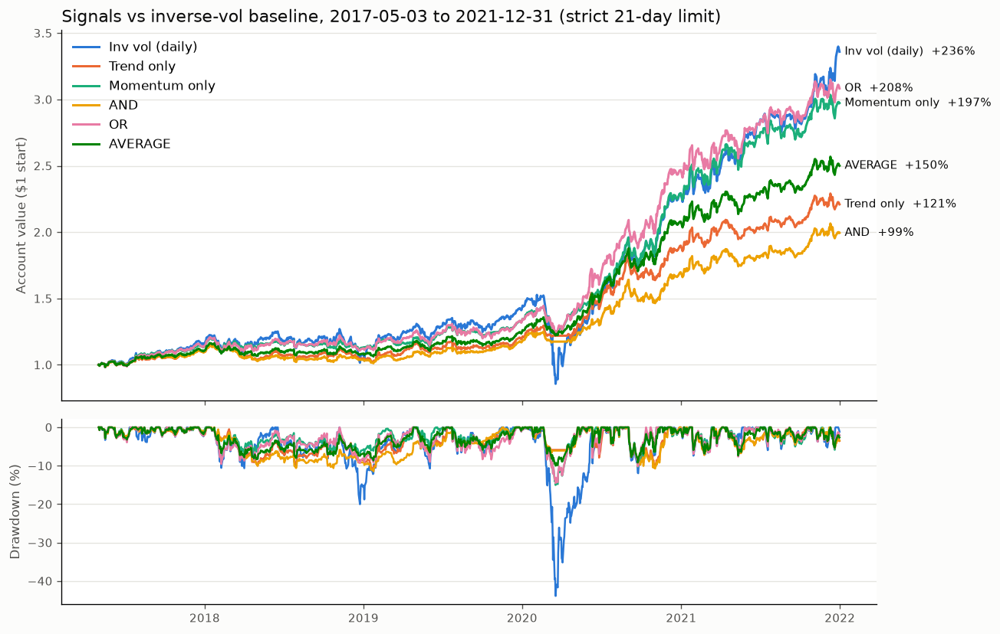

# Trend & Momentum Signals, Explained

Script: `research/signals.py`. Run it with `.venv/bin/python research/signals.py` (takes about 30 seconds).
Chart: `research/signals.png`.
Period: **2017-05-03 to 2021-12-31** (development data only; 2022–23 is never loaded).

---

## 1. What the two signals are

Each signal is computed **separately for each asset**, every morning, using only
closing prices up to **yesterday**.

| Signal | Rule | In plain words |
|---|---|---|
| **Trend filter** | 1 if yesterday's close > average of the last 50 closes, else 0 | "Is the price above where it's been over the last ~2.5 months?" |
| **Time-series momentum** | 1 if the return over the last 126 trading days > 0, else 0 | "Is the price higher than it was ~6 months ago?" |

Both are ways of asking "is this asset going up lately?" The idea is to own an
asset while it's rising and **step aside into cash** while it's falling, which
should mainly help with drawdowns.

**How weights are built:** start from the inverse-volatility weights (the same
ones as baseline #2, which add up to 100%). Multiply each asset's weight by its
signal. If the signal is 0, that slice of the account sits in cash (earning 0%).
So when a signal is off, the account is partly in cash. It is **not**
reshuffled into the other assets.

| Strategy | Each asset's weight = inverse-vol weight × … |
|---|---|
| Trend only | trend signal (0 or 1) |
| Momentum only | momentum signal (0 or 1) |
| AND | 1 only if **both** signals are 1 |
| OR | 1 if **either** signal is 1 |
| AVERAGE | (trend + momentum) / 2, which is 0, 0.5 or 1 |

Weights are recomputed every day (like baseline #2). The backtester's 21-day hold
limit still applies: a position held 21 days is sold, sits out one day, and is
bought back if the signal still says so.

**Why start on 2017-05-03 (not 2017-01-27 like the baseline file)?** Momentum
needs 126 days of history before it can make a decision. **Every strategy,
including the baselines, starts on that same day here**, so the baseline numbers
below differ slightly from `baselines_explained.md`.

---

## 2. Results (main table: strict 21-day hold limit)

Best signal strategy in each row is in **bold**.

| | Equal weight | Inv vol (daily) | Inv vol (monthly) | Trend only | Momentum only | AND | OR | AVERAGE |
|---|---|---|---|---|---|---|---|---|
| Total return | 269.7% | 236.0% | 238.8% | 120.9% | 197.2% | 99.4% | **208.3%** | 150.0% |
| Annualized return | 32.3% | 29.7% | 29.9% | 18.5% | 26.3% | 15.9% | **27.3%** | 21.7% |
| Annualized volatility | 27.5% | 25.6% | 25.8% | 13.6% | 15.0% | **11.8%** | 16.6% | 13.5% |
| **Sharpe ratio** | 1.16 | 1.14 | 1.15 | 1.32 | **1.63** | 1.32 | 1.53 | 1.52 |
| **Max drawdown** | −46.4% | −43.9% | −41.6% | −11.2% | −15.0% | −11.4% | −14.5% | **−10.0%** |
| Calmar (ann. return ÷ max DD) | 0.70 | 0.68 | 0.72 | 1.65 | 1.75 | 1.39 | 1.88 | **2.17** |
| Turnover per year | 26.2x | 27.7x | 23.1x | 30.5x | **24.2x** | 25.3x | 29.5x | 28.5x |
| Total costs paid | 6.12% | 6.47% | 5.40% | 7.11% | **5.65%** | 5.91% | 6.88% | 6.64% |
| Avg % of account invested | 95% | 95% | 95% | 62% | 68% | 51% | 79% | 64% |
| Q4 2018 sell-off (Oct–Dec) | −9.5% | −10.6% | −9.1% | −3.7% | −2.0% | **−1.6%** | −3.9% | −1.9% |
| COVID crash (Feb 19–Mar 23 2020) | −43.4% | −41.5% | −39.5% | **−5.9%** | −14.8% | −6.1% | −14.3% | −9.9% |
| 2020 full year | +76.6% | +61.7% | +60.1% | +58.7% | +72.8% | +44.9% | **+86.4%** | +67.5% |

**Calmar** is a new column: yearly return divided by the worst drawdown. It
measures how much you earn for each 1% of worst-case loss, so higher is better.

### Same thing with the hold limit turned off (for comparison only)

| | Equal weight | Inv vol (daily) | Inv vol (monthly) | Trend only | Momentum only | AND | OR | AVERAGE |
|---|---|---|---|---|---|---|---|---|
| Total return | 277.8% | 249.1% | 248.5% | 135.1% | 215.3% | 115.2% | 244.0% | 173.7% |
| Sharpe ratio | 1.16 | 1.16 | 1.16 | 1.39 | 1.66 | 1.43 | 1.62 | 1.61 |
| Max drawdown | −46.5% | −44.7% | −44.7% | −12.1% | −14.8% | −10.7% | −15.3% | −10.4% |
| Turnover per year | 3.8x | 5.4x | 5.4x | 20.8x | 10.6x | 17.7x | 13.7x | 15.5x |
| Total costs paid | 0.89% | 1.27% | 1.25% | 4.85% | 2.48% | 4.14% | 3.20% | 3.62% |

The ranking is the same with or without the hold limit, so the conclusions don't
depend on how that rule ends up being read.

---

## 3. Which is best, and why

### The big result: every signal version crushes the baselines on risk

All five cut the worst drawdown from about **−44% to between −10% and −15%**,
and raise Sharpe from about **1.15 to 1.3–1.6**. Nearly all of this comes from
one event, the **March 2020 COVID crash**. The baselines lost about 40% in five
weeks. The signal strategies lost 6–15%, because as prices fell below their
averages, the signals switched off one asset at a time and moved the money to
cash. You can see this in the drawdown panel of the chart. The blue baseline
line drops to −44%, and everything else stays above −15%.

The cost: they're in cash 20–50% of the time, so in a strongly rising market
(2016–2021 was one) they make less in total. That's fine, because the scoring
cares most about Sharpe and drawdown.

### Ranking the five

| Rank | Strategy | Why |
|---|---|---|
| 1 | **Momentum only** | Highest Sharpe (1.63), lowest costs of the five, and it keeps most of the return (26% a year vs 30% for the baseline). Drawdown −15%. |
| 2 | **AVERAGE** | Lowest drawdown (−10%) and best Calmar (2.17), with Sharpe 1.52. Earns about 5% a year less than Momentum only. |
| 3 | **OR** | Highest return (27%), Sharpe 1.53, but drawdown −14.5% and high turnover. |
| 4 | Trend only | Great in the COVID crash, but the 50-day average switches on and off too often (see below), so it earns little. |
| 5 | AND | Safest on paper (lowest volatility), but it's in cash half the time, so it has the lowest return. |

**My pick: Momentum only, with AVERAGE as a close second.** If the competition
rewards drawdown more than return, AVERAGE could come out ahead. I'd keep both
as candidates.

### Why momentum beats trend here: signal "jumpiness"

How many times per year each signal switches on↔off, per asset:

| | A | B | C | D | E | F |
|---|---|---|---|---|---|---|
| Trend (50-day average) | 15.0 | 18.2 | 21.0 | 16.3 | 18.0 | 17.8 |
| Momentum (126-day return) | 3.0 | 11.8 | 7.1 | 12.4 | 7.7 | 3.6 |

The 50-day trend signal switches about **18 times a year** per asset. Many of
those are **whipsaws**: the price pokes below its average, you sell, it bounces
back, you buy back higher. Each whipsaw loses a little money and pays costs.
The 6-month momentum signal is much calmer. It mostly stays on during long rises
and turns off during real declines. That's why Trend only has much lower
returns than Momentum only, even though trend got out of the COVID crash faster.

### Why the combinations behave the way they do

- **AND** needs both signals on, so it's out of the market whenever either one
  turns off. That makes it very safe, but you miss a lot of gains.
- **OR** stays in unless both signals turn off. That keeps most of the return,
  but it only gets out in clear, lasting declines.
- **AVERAGE** sells *half* of a position when one signal turns off, and the rest
  when the other does. That's a gentle step down rather than all-or-nothing,
  which is why it has the smallest drawdown. It also smooths out the cost of
  trend's whipsaws, because each flip only moves half a position.

---

## 4. Warnings: don't over-trust these numbers

1. **One crash drives most of the result.** Five years of data hold basically
   one big crash (2020) and one smaller sell-off (late 2018). A strategy that
   happened to dodge 2020 looks brilliant. The 2022 holdout (a slow, grinding
   decline) will be a very different test.
2. **The differences *between* the signal versions are small compared with the
   noise.** With under 5 years of data, a Sharpe ratio has a margin of error of
   roughly ±0.45. So 1.63 vs 1.52 is **not** a real, reliable difference. The
   difference vs the baseline (mostly the drawdown, −15% vs −44%) is much
   bigger and more believable.
3. **The 126-day window looks a bit special.** I re-ran AVERAGE with other
   window lengths (on development data only, starting 2017-10-31 so the 252-day
   version has enough history):

   | Sharpe / Max DD | Momentum 63 days | Momentum 126 days | Momentum 252 days |
   |---|---|---|---|
   | Moving avg 20 days | 1.23 / −14% | 1.51 / −10% | 1.19 / −15% |
   | Moving avg 50 days | 1.39 / −12% | **1.52 / −10%** | 1.33 / −14% |
   | Moving avg 100 days | 1.23 / −17% | 1.46 / −14% | 1.21 / −17% |
   | Moving avg 200 days | 1.22 / −15% | 1.52 / −15% | 1.28 / −19% |

   The good news: **every** setting beats the baseline (Sharpe 1.19–1.52 vs about
   1.15, drawdown −10% to −19% vs −44%). The idea works whichever windows you
   pick. The caution: 126 days is clearly the best momentum window, and the
   ones on either side of it are noticeably worse. That's a sign some of
   the 126-day result is luck. **Don't tune this further on the same data.**
   Picking whichever window looked best is exactly how strategies end up failing
   on the holdout. Treat ~1.3–1.4 as a more realistic Sharpe to expect.
4. **Costs and the hold limit still cost about 3–4% over the period** (compare
   the two tables). Trading only when a signal actually changes, instead of
   re-matching inverse-vol weights every day, could cut that.

---

## 5. Look-ahead checks (all passed)

1. **By-hand check:** on a test day, the trend and momentum signals the code
   computed matched a manual calculation that uses only closes through the day
   before.
2. **Tamper check:** I tripled every price from the decision day onward. The
   weights chosen for that day didn't change, so the strategy can't be
   peeking at today's or future prices.
3. **Truncation check:** for all five strategies, I deleted every row from
   2019-09-04 onward and re-ran. The weights on every earlier day were identical.

Note that the moving average *includes* yesterday's close. That's allowed:
yesterday's close is known before today's open, which is when we trade.

---

## 6. Suggested next steps

- Try the **Momentum only** and **AVERAGE** versions with "trade only when a
  signal changes or the hold limit forces it." That cuts turnover and costs.
- Add a **volatility target** (shrink all weights when the market gets jumpy).
  It could reduce drawdowns further in crashes that signals react to slowly.
- Only after picking a final version: run it **once** on 2022–2023.
